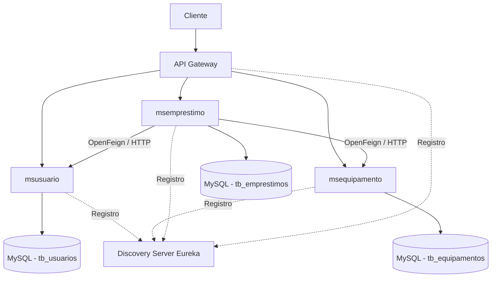

# Sistema de Empréstimo de Equipamentos — Microsserviços

Sistema desenvolvido para gerenciar o empréstimo de equipamentos, permitindo o cadastro de usuários, o gerenciamento de equipamentos e o controle de empréstimos e devoluções.

O projeto utiliza arquitetura de microsserviços com comunicação síncrona via HTTP, descoberta de serviços com Eureka, roteamento através do Spring Cloud Gateway e comunicação entre serviços utilizando OpenFeign.


## 1. Arquitetura da solução

A aplicação está organizada em cinco projetos independentes:

| Microsserviço | Responsabilidade | Banco de dados |
|---|---|---|
| `discovery-server` | Registro e descoberta dos serviços através do Eureka. | Não possui |
| `api-gateway` | Ponto único de entrada e roteamento das requisições. | Não possui |
| `msusuario` | Cadastro e consulta de usuários. | `tb_usuarios` |
| `msequipamento` | Cadastro, consulta, reserva e liberação de equipamentos. | `tb_equipamentos` |
| `msemprestimo` | Coordenação dos empréstimos e devoluções. | `tb_emprestimos` |

### 1.1. Diagrama da arquitetura



### 1.2. Comunicação entre os serviços

A comunicação acontece de forma síncrona, utilizando HTTP e OpenFeign.

O `msemprestimo` é responsável por coordenar o processo de empréstimo:

1. Recebe a solicitação de empréstimo através da API Gateway.
2. Consulta o `msusuario` para verificar se o usuário existe.
3. Consulta o `msequipamento` para verificar a disponibilidade e solicitar a reserva.
4. Após a confirmação da reserva, registra o empréstimo com status `ATIVO`.
5. Retorna a confirmação da operação ao cliente.

Na devolução:

1. O cliente solicita a devolução.
2. O `msemprestimo` solicita a liberação do equipamento ao `msequipamento`.
3. O empréstimo é atualizado para o status `DEVOLVIDO`.

A comunicação entre os microsserviços utiliza descoberta de serviços pelo Eureka e balanceamento de carga pelo Spring Cloud LoadBalancer.

**Importante:** nesta etapa não são utilizados RabbitMQ, Kafka ou qualquer mecanismo de mensageria assíncrona.

## 2. Portas utilizadas

A tabela abaixo apresenta a distribuição de portas para execução local. Os números devem ser conferidos e alinhados com as configurações de cada aplicação.

| Aplicação | Porta |
|---|---:|
| discovery-server | 8761 |
| api-gateway | 8080 |
| msusuario | 8081 |
| msequipamento | 8082 |
| msemprestimo | 8083 |
| MySQL | 3306 |

O Eureka poderá ser acessado pelo navegador:

```text
http://localhost:8761
```

A API Gateway será utilizada como ponto de entrada para as requisições externas:

```text
http://localhost:8080
```

As chamadas realizadas pelo cliente devem utilizar a porta da API Gateway, e não as portas individuais dos microsserviços.


## 3. Instruções para execução

### 3.1. Pré-requisitos

Antes de executar o projeto, é necessário possuir:

- Java 21 instalado.
- Maven instalado ou Maven Wrapper disponível no projeto.
- MySQL instalado e em execução.
- As configurações de conexão com o MySQL corretas para o ambiente local em cada microsserviço.

### 3.2. Ordem de inicialização

Para garantir o funcionamento correto da descoberta e comunicação entre os serviços, recomenda-se iniciar as aplicações na seguinte ordem:

**1º — Discovery Server**

Entre na pasta `discovery-server` e execute:

```bash
./mvnw spring-boot:run
```

Acesse:

```text
http://localhost:8761
```

**2º — Microsserviço de usuários**

Entre na pasta `msusuario` e execute:

```bash
./mvnw spring-boot:run
```

**3º — Microsserviço de equipamentos**

Entre na pasta `msequipamento` e execute:

```bash
./mvnw spring-boot:run
```

**4º — Microsserviço de empréstimos**

Entre na pasta `msemprestimo` e execute:

```bash
./mvnw spring-boot:run
```

**5º — API Gateway**

Entre na pasta `api-gateway` e execute:

```bash
./mvnw spring-boot:run
```

Após iniciar todas as aplicações, acesse o Eureka para verificar se os quatro serviços foram registrados corretamente:

```text
http://localhost:8761
```

No Windows, caso necessário, utilize `mvnw.cmd spring-boot:run` no lugar de `./mvnw spring-boot:run`.

## 4. Exemplos de requisições da aplicação

Todas as requisições externas devem ser realizadas através da API Gateway.

URL base:

```text
http://localhost:8080
```

### 4.1. Microsserviço de usuários — msusuario

| Método | Endpoint | Descrição |
|---|---|---|
| POST | `/api/v1/usuarios` | Cadastrar usuário |
| GET | `/api/v1/usuarios/{id}` | Consultar usuário por ID |

**Cadastrar usuário**

```http
POST http://localhost:8080/api/v1/usuarios
Content-Type: application/json
```

Exemplo de corpo:

```json
{
  "nome": "João da Silva",
  "email": "joao@email.com",
  "matricula": "2026001"
}
```

**Consultar usuário**

```http
GET http://localhost:8080/api/v1/usuarios/11111111-1111-1111-1111-111111111111
```

### 4.2. Microsserviço de equipamentos — msequipamento

| Método | Endpoint | Descrição |
|---|---|---|
| POST | `/api/v1/equipamentos` | Cadastrar equipamento |
| GET | `/api/v1/equipamentos/{id}` | Consultar equipamento por ID |
| GET | `/api/v1/equipamentos/disponiveis` | Listar equipamentos disponíveis |
| PUT | `/api/v1/equipamentos/{id}/reservas/{emprestimoId}` | Reservar equipamento |
| DELETE | `/api/v1/equipamentos/{id}/reservas/{emprestimoId}` | Liberar equipamento |

**Cadastrar equipamento**

```http
POST http://localhost:8080/api/v1/equipamentos
Content-Type: application/json
```

Exemplo de corpo:

```json
{
  "nome": "Notebook Dell",
  "tipo": "NOTEBOOK",
  "patrimonio": "PAT-001",
  "disponivel": true
}
```

**Consultar equipamento**

```http
GET http://localhost:8080/api/v1/equipamentos/22222222-2222-2222-2222-222222222222
```

**Listar equipamentos disponíveis**

```http
GET http://localhost:8080/api/v1/equipamentos/disponiveis
```

**Reservar equipamento**

```http
PUT http://localhost:8080/api/v1/equipamentos/22222222-2222-2222-2222-222222222222/reservas/33333333-3333-3333-3333-333333333333
```

**Liberar equipamento**

```http
DELETE http://localhost:8080/api/v1/equipamentos/22222222-2222-2222-2222-222222222222/reservas/33333333-3333-3333-3333-333333333333
```

A reserva deve ser idempotente, utilizando o `emprestimoId` como identificador estável. A mesma solicitação não poderá reservar o equipamento novamente.

### 4.3. Microsserviço de empréstimos — msemprestimo

| Método | Endpoint | Descrição |
|---|---|---|
| POST | `/api/v1/emprestimos` | Solicitar empréstimo |
| GET | `/api/v1/emprestimos/{id}` | Consultar empréstimo por ID |
| GET | `/api/v1/emprestimos/usuarios/{usuarioId}` | Consultar empréstimos de um usuário |
| PATCH | `/api/v1/emprestimos/{id}/devolucao` | Registrar devolução |

**Solicitar empréstimo**

```http
POST http://localhost:8080/api/v1/emprestimos
Content-Type: application/json
```

Exemplo de corpo:

```json
{
  "usuarioId": "11111111-1111-1111-1111-111111111111",
  "equipamentoId": "22222222-2222-2222-2222-222222222222"
}
```

Exemplo de resposta esperada:

```http
HTTP/1.1 201 Created
```

```json
{
  "id": "33333333-3333-3333-3333-333333333333",
  "usuarioId": "11111111-1111-1111-1111-111111111111",
  "equipamentoId": "22222222-2222-2222-2222-222222222222",
  "status": "ATIVO"
}
```

**Consultar empréstimo por ID**

```http
GET http://localhost:8080/api/v1/emprestimos/33333333-3333-3333-3333-333333333333
```

**Consultar empréstimos de um usuário**

```http
GET http://localhost:8080/api/v1/emprestimos/usuarios/11111111-1111-1111-1111-111111111111
```

**Registrar devolução**

```http
PATCH http://localhost:8080/api/v1/emprestimos/33333333-3333-3333-3333-333333333333/devolucao
```

A devolução deve solicitar a liberação do equipamento e atualizar o status do empréstimo para `DEVOLVIDO`, sem executar a liberação duas vezes.


## Etapa 2 — condição do equipamento, OpenFeign e Circuit Breaker

- `PUT /api/v1/equipamentos/{id}/condicao` recebe `{ "condicao": "BOM" }` ou `{ "condicao": "AVARIADO" }`.
- `PUT /api/v1/emprestimos/{id}/devolucao` agora recebe o mesmo corpo JSON.
- A devolução atualiza a condição via OpenFeign antes de liberar a reserva e marcar o empréstimo como `DEVOLVIDO`.
- A nova chamada é protegida pelo Circuit Breaker Resilience4j (`equipamentoCondicao`); indisponibilidade retorna HTTP 503 e equipamento inexistente permanece HTTP 404.
- Equipamentos existentes recebem `BOM` por padrão pela migração Flyway V2.

Exemplo de devolução:

```http
PUT /api/v1/emprestimos/{id}/devolucao
Content-Type: application/json
```

```json
{
  "condicao": "AVARIADO"
}
```
